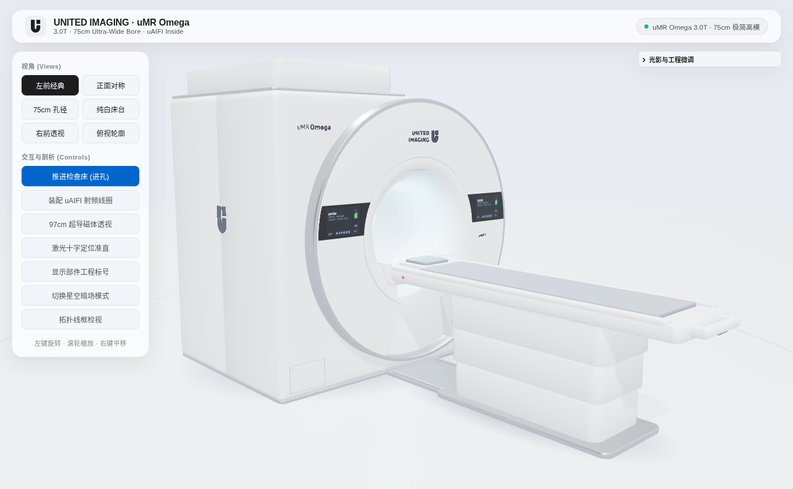

# UNITED IMAGING · uMR Omega 3.0T — MRI 3D Digital Twin (Three.js + Blender)

高保真联影风格（uMR Omega 3.0T · 75cm 超大孔径）核磁共振大型医疗设备真实 3D 数字化孪生工程。



本项目构建了 **Blender 工业级 3D 资产管线** 与 **Three.js WebGL 真实感渲染引擎** 的无缝协作工程架构。内置 1:1 公制联影风格纯白极简 3D 高模（`public/models/mri_scanner.glb`）、Blender 源工程（`blender/mri_scanner.blend`）及全套自动化建模与贴图生成脚本。

---

## 🌟 核心特性 (Features)

* **联影 uMR Omega 3.0T 极简工业设计还原 (`Blender 4.x` + `glTF 2.0`)**:
  * 对标联影官方实机摄影与 Apple 级极简工业美学：左侧垂直落地纯白方体与右侧同心圆弧相切过渡（标志性非对称 P-Arch 建筑体块），顶部采用全封闭圆角纯白恒温冷头舱，底部与顶部镶嵌纤细喷砂阳极氧化银铝饰边。
  * 外凸纯白圆形前盘外圈环绕一整圈喷砂阳极氧化铝饰环；正面 3 点与 9 点位 **0 凸起纯平嵌入** 同心圆弧梯形曜石黑晶 OLED 触控屏；机身字符与联影 `U` 盾徽采用 2K Alpha 镂空银灰金属贴花直接印制于纯白表面。
  * **75cm 超大孔径 + 纯白三段式升降床**：纯白一体渐扩喇叭口与底部 U 型床槽、纤细月牙氛围灯条、顶部 Starlight 星空穹顶；三段圆角跑道型纯白套筒升降床搭配喷砂银铝地台、浅鸽灰抗菌软垫与一体环状扶手。
* **极速加载优化（仅 746 KB）**:
  * 全四边面精简拓扑 + 高压缩比内嵌贴图，GLB 模型体积缩减至 **746 KB**（较初代缩减近 77%），配合 Vite 分块生产构建实现秒级载入。
* **纯净白演播室 / 星空暗场双模式 & 97cm 净磁体透视**:
  * 默认采用联影/Apple 摄影棚无影纯白环氧地坪与柔光箱负补光 IBL；支持一键切换 **星空暗场模式**、**装配/卸下纯白 uAIFI 射频线圈**、**97cm 超导磁体透视剖析** 与 **激光十字定位**。

---

## 📁 项目目录结构 (Directory Structure)

```text
mri-3d-visualizer/
├── .gitignore                    # Git 忽略配置
├── package.json                  # 依赖配置 (Three.js, lil-gui, Vite, TypeScript)
├── tsconfig.json                 # TypeScript 严格模式配置
├── vite.config.ts                # Vite 前端构建配置
├── index.html                    # 宿主页面与医疗工作站 HUD 界面
├── README.md                     # 项目技术文档与开发指引
│
├── blender/                      # Blender 工业建模资产与自动化脚本
│   ├── README.md                 # 3D 建模尺寸规范、PBR 材质与层级指南
│   ├── generate_textures.py      # 高清 PBR 贴图程序化生成器 (触控屏UI/铭牌/吸音孔/皮革)
│   ├── build_mri_scanner.py      # Blender 4.x 全自动工业级 MRI 3D 建模与导出脚本
│   ├── export_gltf.py            # 独立 glTF/GLB 导出辅助脚本
│   ├── mri_scanner.blend         # 可直接打开二次编辑的 Blender 源工程文件
│   └── textures/                 # 高清 PBR 贴图素材
│
├── public/                       # 静态资源
│   ├── favicon.svg               # 设备 SVG 图标
│   └── models/                   # WebGL 运行期 3D 模型资产目录
│       └── mri_scanner.glb       # 高保真 3.0T MRI glTF 2.0 二进制模型 (已内嵌贴图)
│
└── src/                          # 前端源码
    ├── assets/styles/main.css    # 现代医用工作站深色玻璃态主题
    ├── config/constants.ts       # 6 组视角预设与 6 大核心部件工程标注数据
    ├── core/
    │   ├── Viewer.ts             # 渲染器核心、演播室 HDRI IBL 与摄像机过渡
    │   ├── Lighting.ts           # 医用演播室多点照明、孔环呼吸光与激光十字准直
    │   └── Environment.ts        # 洁净室反光地坪、五高斯安全警戒线与参考网格
    ├── components/
    │   ├── ModelLoader.ts        # GLTF 加载器、部件绑定、透视剖析与线圈显隐
    │   ├── PlaceholderMRI.ts     # 几何工程占位回退模型
    │   └── Annotations.ts        # 3D 空间交互热点标签与视口平滑聚焦
    ├── ui/
    │   ├── GUIControls.ts        # lil-gui 材质、线圈、透视与光照实时参数面板
    │   └── LoadingOverlay.ts     # 动态加载进度遮罩
    └── main.ts                   # 应用程序主入口
```

---

## 🚀 快速启动 (Quick Start)

### 1. 安装依赖

确保已安装 [Node.js](https://nodejs.org/) (推荐 v18+ 或最新 LTS 版)：

```bash
cd mri-3d-visualizer
npm install
```

### 2. 启动本地开发服务

```bash
npm run dev
```

终端将输出本地访问地址（例如 `http://localhost:3000/`），在浏览器中打开即可查看当前高保真 MRI 3D 交互场景。

### 3. 构建生产版本

```bash
npm run build
```

打包产物将输出至 `dist/` 目录，可直接部署至任何静态 Web 服务器（如 Nginx、GitHub Pages、Vercel 等）。

---

## 🎨 Blender 制作与模型替换流程 (Blender Workflow)

详细的建模工艺与层级规范请参阅 [blender/README.md](./blender/README.md)。

1. **建模制作**:
   在 Blender 中遵循 1:1 公制尺寸建模，确保物体原点统一位于机架底面中心，并完成 `Ctrl + A` -> `Apply All Transforms`。
2. **材质规范**:
   使用标准 `Principled BSDF` 节点制作 PBR 材质（金属度、粗糙度、法线贴图、自发光）。
3. **一键导出**:
   * 打开 `blender/export_gltf.py` 脚本并在 Blender Scripting 窗口中运行；
   * 或手动导出为 `glTF Binary (.glb)`，启用 Draco 压缩；
   * 将导出的文件保存为：`public/models/mri_scanner.glb`。
4. **刷新浏览器**:
   页面将自动检测到该文件，顶部状态徽章变更为绿色 **“Blender GLB 真实模型已挂载”**，无缝呈现高模效果。

---

## 📤 提交至 GitHub 仓库说明 (Pushing to GitHub)

本地已完成 Git 初始化与初次代码提交。若要推送到您自己的 GitHub 仓库，请执行以下命令：

```bash
# 1. 在 GitHub 上新建一个仓库（例如名为 mri-3d-visualizer）
# 2. 将本地分支关联到您的远程仓库 (将 YOUR_USERNAME 替换为您的 GitHub 用户名)
git remote add origin https://github.com/YOUR_USERNAME/mri-3d-visualizer.git

# 3. 推送主分支代码到 GitHub
git branch -M main
git push -u origin main
```

---

## 📄 开源许可证 (License)

本项目采用 [MIT License](https://opensource.org/licenses/MIT) 开源许可证。


---

## 🔬 新增：MR / MI / CT 三模态设备矩阵与云端精修指南

本仓库现已扩充支持联影三大旗舰模态设备，顶部导航栏可直接切换预览（亦可通过 `?model=uexplorer` 或 `?model=uct` 参数直达）：

| 模态 | 机型 | 运行时模型路径 | Blender 自动化生成脚本 |
| :--- | :--- | :--- | :--- |
| **MR** | **uMR Omega 3.0T**（75cm 孔径 · 97cm 超导磁体） | `public/models/mri_scanner.glb` | `blender/generate_textures.py` + `blender/build_mri_scanner.py` |
| **MI** | **uEXPLORER® 探索者**（76cm 孔径 · 194cm 8环全景 PET + 160层 CT） | `public/models/uexplorer.glb` | `blender/generate_uexplorer_textures.py` + `blender/build_uexplorer.py` |
| **CT** | **uCT 960+ 宽体螺旋CT**（82cm 孔径 · 320排宽体探测器） | `public/models/uct_scanner.glb` | `blender/build_uexplorer.py -- --ct-only` |

### 云端 Blender 一键重烘焙命令 (`uEXPLORER` & `uCT 960+`)

在云端工作站完成 `build_uexplorer.py` 细节调优后，执行以下命令即可更新 `.blend` 源工程并直接覆盖 `public/models/` 下的 `.glb` 模型：

```bash
# 1. 生成 2K 联影品牌贴花、四联触控屏 UI 与星空孔道贴图
python blender/generate_uexplorer_textures.py

# 2. 烘焙导出 MI 旗舰：uEXPLORER 探索者 -> public/models/uexplorer.glb & blender/uexplorer.blend
blender --background --python blender/build_uexplorer.py

# 3. 烘焙导出派生 CT：uCT 960+ -> public/models/uct_scanner.glb & blender/uct_scanner.blend
blender --background --python blender/build_uexplorer.py -- --ct-only
```
